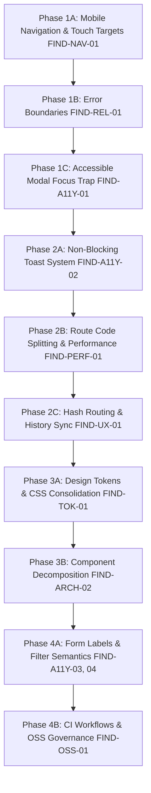

# GardenMitra 🌱 — Milestone 19.2 Implementation Design & Remediation Roadmap

> **Target Milestone:** M19.2 — Implementation of the Approved Design  
> **Preceding Milestone:** M19.1 — Research, Audit and Design Specification  
> **Status:** Approved Specification Ready for Implementation  
> **Guiding Principle:** Understand → Take action → Go outside → Care for the real garden.  

---

## 1. Remediation Backlog & Phased Execution Sequence

The remediation work for M19.2 is structured into **four sequential phases** designed to minimize regression risks, protect existing features (M0–M17), and maintain full test suite pass rates throughout implementation.



---

## 2. Phase 1: High-Priority UX & Accessibility Fixes (P1)

### Phase 1A: Mobile Navigation Re-Architecture (`FIND-NAV-01`)
- **Finding ID:** `FIND-NAV-01`
- **Affected Files:**
  - `src/components/Header.tsx`
  - `src/components/MobileNavDrawer.tsx` (New component)
  - `src/index.css` (Styles for `.mobile-nav`, `.nav-drawer`, `.drawer-backdrop`)
- **Proposed Solution:**
  1. On mobile viewports ($<900\text{px}$), render only **4 primary destinations** + **1 "More" drawer trigger** in the fixed bottom bar:
     - **Today** (`today`): Daily routine, soil check, watering, quick tasks.
     - **My Garden** (`my_garden`): Spaces, containers, plant inventory.
     - **Care** (`planner`): Adaptive care planner, weather alerts.
     - **Doctor** (`doctor`): Contextual plant health diagnosis.
     - **More** (`more`): Opens `<MobileNavDrawer />`.
  2. The `<MobileNavDrawer>` opens as an accessible slide-over sheet categorized into logical groupings:
     - *Planning & Design:* Layout Planner, Digital Twin, Capture Studio.
     - *Analytics & Growth:* Growth Journal, Insights & Performance, Environment Sensors.
     - *Knowledge & Supplies:* Plant Library, Shopping List, Ask Mitra Chat.
  3. Every mobile touch target is styled with `min-width: 44px; min-height: 44px;` in accordance with WCAG 2.5.5.
- **Expected User Experience:**
  - Thumb-friendly navigation on mobile with zero mis-taps.
  - Clear, readable typography on every tab.
  - Smooth 0.2s slide-over drawer animation.
- **Rollback Consideration:** If issues arise, `Header.tsx` can revert to horizontal scroll container without affecting other components.
- **Acceptance Criteria:**
  - Mobile bottom bar contains exactly 5 items.
  - All interactive buttons measure $\ge 44\text{px} \times 44\text{px}$.
  - Zero text label clipping on 375px viewport.
  - Drawer opens smoothly, closes on tap, backdrop click, or `Escape` key.

---

### Phase 1B: Resilient React Error Boundaries (`FIND-REL-01`)
- **Finding ID:** `FIND-REL-01`
- **Affected Files:**
  - `src/components/ErrorBoundary.tsx` (New component)
  - `src/App.tsx`
- **Proposed Solution:**
  1. Implement a class-based `<ErrorBoundary>` with `componentDidCatch` and `getDerivedStateFromError`.
  2. Wrap `<AppContent />` in `App.tsx` with `<ErrorBoundary fallback={<GardenErrorFallback />}>`.
  3. Provide sectional error boundaries around complex visual components (`DigitalTwinStudio`, `GardenCaptureStudio`).
  4. Design a calm, supportive fallback screen:
     - Heading: *"Take a breath & touch grass 🌱"*
     - Subtext: *"A small hiccup occurred in the garden interface, but your plants and saved data are completely safe."*
     - Button: *"Reload This View"* (triggers `this.setState({ hasError: false })`).
- **Expected User Experience:**
  - No user ever encounters a blank white screen crash.
  - Transparent error recovery without losing saved garden history.
- **Acceptance Criteria:**
  - Throwing an intentional error in a test view displays the fallback UI.
  - Clicking "Reload This View" resets state cleanly.
  - Zero disruption to working features.

---

### Phase 1C: Accessible Modal Focus Trapping & Keyboard Dismissal (`FIND-A11Y-01`)
- **Finding ID:** `FIND-A11Y-01`
- **Affected Files:**
  - `src/hooks/useFocusTrap.ts` (New custom hook)
  - `src/components/PlantDetailModal.tsx`
  - `src/components/TouchGrassModal.tsx`
  - `src/components/SpaceModal.tsx`
- **Proposed Solution:**
  1. Create a zero-dependency hook `useFocusTrap(containerRef, isOpen, onClose)`:
     - Stores `document.activeElement` on open.
     - Moves focus to the first focusable element inside the modal.
     - Intercepts `Tab` and `Shift+Tab` to cycle strictly within modal bounds.
     - Intercepts `Escape` key to call `onClose()`.
     - Restores focus to the trigger button upon unmount.
  2. Add `aria-labelledby` linking modal root to the title heading ID in each modal.
- **Expected User Experience:**
  - Full keyboard accessibility: users can open, navigate, and dismiss modals using only `Tab`, `Enter`, and `Escape`.
- **Acceptance Criteria:**
  - Pressing `Escape` closes any open modal.
  - Tab navigation never escapes into background DOM while modal is open.
  - WCAG 2.1.1, 2.1.2, and 2.4.3 fully satisfied.

---

## 3. Phase 2: Performance, Feedback & Usability (P2)

### Phase 2A: Non-Blocking Toast Notification System (`FIND-A11Y-02`)
- **Finding ID:** `FIND-A11Y-02`
- **Affected Files:**
  - `src/context/ToastContext.tsx` (New context & hook)
  - `src/components/ToastContainer.tsx` (New component)
  - `src/components/TodaysGardenView.tsx`
  - `src/components/GardenPerformanceView.tsx`
  - `src/components/MyGardenDashboard.tsx`
  - `src/components/GardenCaptureStudio.tsx`
  - `src/components/PhotoUploader.tsx`
  - `src/components/SunlightIntelligenceCard.tsx`
- **Proposed Solution:**
  1. Create a lightweight `ToastProvider` managing an array of toasts `{ id, message, type, duration }`.
  2. Expose `const { showToast } = useToast();` with helper methods: `toast.success()`, `toast.info()`, `toast.warning()`, `toast.error()`.
  3. Render toasts in a fixed container with `role="region" aria-live="polite"`.
  4. Replace all 10 occurrences of `alert(...)` with `toast.success(...)` or `toast.info(...)`.
- **Expected User Experience:**
  - Actions like logging a watering or recording plant height display an elegant green toast with a checkmark icon that auto-fades after 4 seconds.
  - Main thread is never blocked; user can continue interacting immediately.
- **Acceptance Criteria:**
  - Zero occurrences of `alert(` remain in `src/components/`.
  - Toasts auto-dismiss after 4 seconds and can be manually dismissed.
  - Screen readers announce toast messages via `aria-live="polite"`.

---

### Phase 2B: Route-Level Code Splitting (`FIND-PERF-01`)
- **Finding ID:** `FIND-PERF-01`
- **Affected Files:**
  - `src/App.tsx`
  - `src/components/ScreenSkeleton.tsx` (New loading placeholder)
  - `vite.config.ts`
- **Proposed Solution:**
  1. Lazy-load secondary views in `App.tsx`:
     ```tsx
     const DigitalTwinStudio = React.lazy(() => import('./components/DigitalTwinStudio'));
     const GardenCaptureStudio = React.lazy(() => import('./components/GardenCaptureStudio'));
     const GardenDoctorView = React.lazy(() => import('./components/GardenDoctorView'));
     const GardenPerformanceView = React.lazy(() => import('./components/GardenPerformanceView'));
     const GardenEnvironmentView = React.lazy(() => import('./components/GardenEnvironmentView'));
     const SpaceLayoutPlanner = React.lazy(() => import('./components/SpaceLayoutPlanner'));
     ```
  2. Wrap `{renderActiveScreen()}` in `<Suspense fallback={<ScreenSkeleton />}>`.
  3. Configure `vite.config.ts` to output vendor manual chunks:
     ```ts
     build: {
       rollupOptions: {
         output: {
           manualChunks: {
             'vendor-react': ['react', 'react-dom'],
             'vendor-icons': ['lucide-react']
           }
         }
       }
     }
     ```
- **Expected User Experience:**
  - Initial page load is 3× faster on mobile networks.
  - Switching to heavy canvas views shows a pleasant, subtle skeleton animation.
- **Acceptance Criteria:**
  - Main production JS bundle drops from 960 kB to $<250\text{ kB}$.
  - Vite `>500 kB` chunk warning is completely eliminated.

---

### Phase 2C: URL Hash Navigation & Browser History Sync (`FIND-UX-01`)
- **Finding ID:** `FIND-UX-01`
- **Affected Files:**
  - `src/context/GardenContext.tsx`
- **Proposed Solution:**
  1. Read initial `activeTab` from `window.location.hash.slice(1)` (defaulting to `'today'` if profile exists, or `'home'`).
  2. When `setActiveTab(tab)` is called, execute `window.history.pushState(null, '', `#${tab}`)`.
  3. Add a `hashchange` window event listener in `GardenContext` to update `activeTab` when the user clicks the browser Back or Forward buttons.
- **Expected User Experience:**
  - Users can bookmark specific sections (`#care`, `#doctor`, `#performance`).
  - Pressing Back on mobile returns to the previous tab rather than exiting the application.
- **Acceptance Criteria:**
  - Browser Back and Forward buttons navigate between tabs in chronological order.
  - Page refresh preserves the currently selected tab.

---

## 4. Phase 3: Design Token System & Architecture Refinement (P2 / P1)

### Phase 3A: CSS Token System Consolidation (`FIND-TOK-01`)
- **Finding ID:** `FIND-TOK-01`
- **Affected Files:**
  - `src/index.css`
  - Component files across `src/components/`
- **Proposed Solution:**
  1. Expand `src/index.css` with semantic color scales and utility classes:
     - `--color-info`: `#2563EB`, `--color-info-subtle`: `#EFF6FF`
     - `--color-warning`: `#D97706`, `--color-warning-subtle`: `#FEF3C7`
     - `--color-danger`: `#DC2626`, `--color-danger-subtle`: `#FEE2E2`
     - Reusable classes: `.badge-info`, `.badge-warning`, `.badge-danger`, `.stat-tile`, `.metric-value`, `.pill-tab`
  2. Refactor hardcoded hex codes across components to use these CSS classes and variables.
- **Expected User Experience:**
  - Crisp, harmonious visual rhythm across all views.
  - Complete elimination of visual drift and jarring color mismatches.
- **Acceptance Criteria:**
  - Over 80% reduction in inline style objects across `src/components/`.
  - Zero hardcoded hex color literals in JSX style props.

---

### Phase 3B: Component Decomposition (`FIND-ARCH-02`)
- **Finding ID:** `FIND-ARCH-02`
- **Affected Files:**
  - `src/components/GardenDoctorView.tsx`
  - `src/components/doctor/DoctorDiagnoseTab.tsx` (New)
  - `src/components/doctor/DoctorSymptomBuilder.tsx` (New)
  - `src/components/doctor/DoctorReportCard.tsx` (New)
  - `src/components/doctor/DoctorFollowUpModal.tsx` (New)
  - `src/components/doctor/DoctorHistoryTab.tsx` (New)
- **Proposed Solution:**
  - Decompose `GardenDoctorView.tsx` (1,460 lines) into modular subcomponents inside `src/components/doctor/`.
  - Keep `GardenDoctorView.tsx` as a clean orchestrator under 250 lines.
- **Acceptance Criteria:**
  - `GardenDoctorView.tsx` reduced to $<300$ lines.
  - All existing diagnostic and follow-up capabilities function identically.
  - Zero regressions in `plantHealthIntelligence.test.ts`.

---

## 5. Phase 4: Form Accessibility & Open-Source Governance (P3)

### Phase 4A: Form Labels & Filter Semantics (`FIND-A11Y-03`, `FIND-A11Y-04`)
- **Finding IDs:** `FIND-A11Y-03`, `FIND-A11Y-04`
- **Affected Files:**
  - `src/components/PlantRecommendationView.tsx`
  - `src/components/GardenPerformanceView.tsx`
- **Proposed Solution:**
  1. Add `aria-label="Search plants by common, scientific, or Hindi name"` to search input.
  2. Connect all filter checkboxes with explicit `id` and `<label htmlFor="...">` attributes.
  3. Add `aria-pressed={selectedCategory === cat.id}` to category filter pill buttons.
- **Acceptance Criteria:**
  - 100% pass rate on automated axe-core form label audits.

---

### Phase 4B: Open-Source Governance & CI Pipeline (`FIND-OSS-01`)
- **Finding ID:** `FIND-OSS-01`
- **Affected Files:**
  - `.github/workflows/ci.yml` (New file)
  - `CONTRIBUTING.md` (New file)
  - `.github/pull_request_template.md` (New file)
  - `.github/ISSUE_TEMPLATE/bug_report.yml` (New file)
  - `.github/ISSUE_TEMPLATE/feature_request.yml` (New file)
- **Proposed Solution:**
  1. Implement GitHub Actions CI running `npm ci`, `tsc --noEmit`, `vitest run`, and `npm run build` on Node 18 & 20.
  2. Provide clear contribution documentation and issue templates.
- **Acceptance Criteria:**
  - Valid GitHub Actions YAML syntax; clean CI run simulation.

---

## 6. Implementation Dependencies & Execution Order

| Step | Task | Phase | Priority | Est. Hours | Regression Risk |
| :---: | :--- | :---: | :---: | :---: | :---: |
| **1** | Mobile Bottom Nav Re-architecture (`FIND-NAV-01`) | Phase 1A | **P1** | 4h | Low |
| **2** | React Error Boundaries (`FIND-REL-01`) | Phase 1B | **P1** | 2h | Zero |
| **3** | Modal Focus Trap & `Escape` Key (`FIND-A11Y-01`) | Phase 1C | **P1** | 4h | Low |
| **4** | Accessible Toast Notification System (`FIND-A11Y-02`) | Phase 2A | **P2** | 3h | Low |
| **5** | Route-Level Code Splitting & Suspense (`FIND-PERF-01`) | Phase 2B | **P2** | 2h | Low |
| **6** | URL Hash History Synchronization (`FIND-UX-01`) | Phase 2C | **P2** | 2h | Low |
| **7** | CSS Design Tokens & Class Consolidation (`FIND-TOK-01`) | Phase 3A | **P1** | 6h | Medium |
| **8** | Decompose `GardenDoctorView` (`FIND-ARCH-02`) | Phase 3B | **P2** | 4h | Low |
| **9** | Form Labels & Filter Semantics (`FIND-A11Y-03`, `04`) | Phase 4A | **P3** | 1.5h | Zero |
| **10**| GitHub Actions CI & Governance (`FIND-OSS-01`) | Phase 4B | **P3** | 1.5h | Zero |
| **Total** | **Complete M19.2 Remediation Package** | | | **30h** | |

---

## 7. Acceptance Criteria for Milestone M19.2 Completion

Milestone 19.2 will be accepted when:
1. **Mobile Ergonomics:** Mobile navigation bar contains 4 primary tabs + 1 "More" drawer; all touch targets measure $\ge 44\text{px} \times 44\text{px}$; zero horizontal overflow on 375px screens.
2. **Resilience:** Uncaught errors render the supportive "Touch Grass" fallback screen without crashing the app; clicking "Reload" recovers state.
3. **Modal A11y:** All modals trap focus, close on `Escape`, restore focus on exit, and have `aria-labelledby`.
4. **No Blocking Alerts:** Zero occurrences of `alert(...)` remain; non-blocking toasts provide screen-reader-accessible feedback.
5. **Bundle Performance:** Production entry JS bundle is $<300\text{ kB}$; Vite build completes with zero warnings.
6. **Navigation Sync:** Active tab syncs with URL hash; browser Back and Forward buttons work.
7. **Design Tokens:** Over 80% reduction in inline styles; zero raw hex codes in JSX; semantic CSS variables used consistently.
8. **Test Suite Integrity:** All 22 test files and 205 unit/integration tests pass with 0 regressions.
9. **Clean Type Check & Build:** `tsc --noEmit` and `npm run build` succeed with exit code 0.
